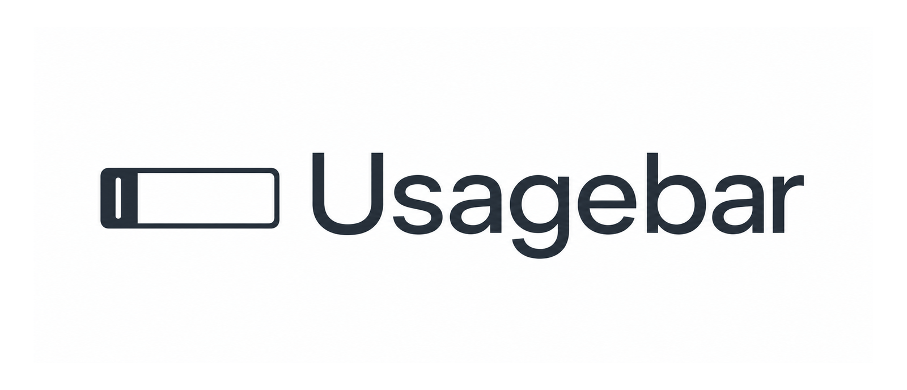

<div align="center">
  

  <p><strong>Claude Code, Codex, Cursor, Kimi Code, z.ai, and Grok usage limits, directly in your macOS menu bar.</strong></p>
  <p>A free, private, native Mac app that shows your 5-hour window, weekly cap, and when each one resets, without opening a browser.</p>

  <p>
    <a href="https://github.com/betoxf/Usagebar/actions/workflows/ci.yml"></a>
    <a href="https://github.com/betoxf/Usagebar/releases/latest"></a>
    
    
    <a href="LICENSE"></a>
  </p>

  <p>
    <a href="https://bullfighterstudio.com/usagebar">Website</a> ·
    <a href="#installation">Install</a> ·
    <a href="#how-it-works">How it works</a> ·
    <a href="CHANGELOG.md">Changelog</a> ·
    <a href="docs/ARCHITECTURE.md">Architecture</a> ·
    <a href="CONTRIBUTING.md">Contributing</a> ·
    <a href="SECURITY.md">Security</a>
  </p>
</div>

<p align="center">
  
</p>

<p align="center">
  
</p>

## Why Usagebar

Usage limits matter most while you are working. Usagebar keeps your Claude Code, Codex, and Cursor limits (the current five-hour window and the weekly allowance) visible in the menu bar, then gets out of the way. Right-click it for a panel with every provider, a meter for each limit, and its reset time.

| Capability | What it gives you |
| --- | --- |
| Multiple providers | Track Claude, Codex, KimiCode, Cursor, z.ai, and XAI (Grok Build) from one status item. |
| At-a-glance limits | See rolling-window and weekly percentages without opening a browser. |
| Focus-aware switching | Show the provider of the AI tool you used last: the Claude, ChatGPT/Codex, Cursor or Grok Bot, KimiCode, ZCode, or Grok app, or the Claude Code, Codex, Cursor, Kimi, or Grok CLI running in your terminal. |
| Usage panel | One card per provider with its plan, a meter per limit, and the time until it resets. Click a card to show that provider in the menu bar. |
| Local credential discovery | Reuse the Claude Code, Codex, Cursor, Kimi Code, z.ai, and Grok sign-ins already on the Mac. No API keys to paste. |
| Privacy-first operation | No Usagebar account, telemetry, analytics, or intermediary backend. |
| Lightweight runtime | A native Swift menu-bar app with no web runtime or bundled service. |

## Installation

### Homebrew (recommended)

```bash
brew install --cask betoxf/tap/usagebar
```

Upgrade later with `brew update && brew upgrade --cask usagebar`.

### Download a release

Download `Usagebar.zip` from the [latest release](https://github.com/betoxf/Usagebar/releases/latest). Quit any running Usagebar, replace `/Applications/Usagebar.app`, and launch the replacement. Do not keep or launch another copy from Downloads.

> [!NOTE]
> Current release artifacts are not notarized. The Homebrew cask clears the quarantine attribute during installation. If you prefer not to do that, build from source.

### Requirements

- macOS 14 Sonoma or newer
- A supported provider account
- For zero-setup discovery, an authenticated Claude, Codex, or Kimi Code CLI session

## Quick start

1. Install and launch Usagebar.
2. If you already use the provider CLIs, Usagebar discovers their local credentials automatically.
3. Right-click the menu-bar item to open the usage panel. Left-click switches providers. Settings are under the panel's **⋯** button.

If a provider is not detected, authenticate its CLI and ask Usagebar to rediscover credentials:

```bash
claude login
codex login
kimi login
```

Claude also supports an in-app browser-session fallback from **Setup Usage Tracking**.

### If Claude shows "Session expired" or authentication fails

Re-authenticate from the terminal — this is the reliable fix:

1. Open Terminal and run `claude` (or `claude login`).
2. Complete the login it prompts for.
3. Click **Refresh** in Usagebar. Usage appears within a few seconds.

Usagebar reads the credentials Claude Code writes locally and never rotates
them itself, so a fresh terminal login is always picked up automatically.

Cursor is discovered from the Cursor.app or Cursor Agent CLI login (no extra
setup). z.ai appears when a `Z_AI_API_KEY` is configured (environment variable or
`~/.zai/config.json` with `{"apiKey": "..."}`).

KimiCode is discovered from `~/.kimi-code/credentials/kimi-code.json` after
`kimi login`. Usagebar uses the same Kimi Code usage source as CodexBar and
shows the weekly quota plus the rolling five-hour window. A Kimi Code API key
or `kimi-auth` web token can also be saved from **Set Up KimiCode…**.

### Fewer menu-bar icons

Since Usagebar already shows your providers' usage, their own menu-bar icons
are redundant. The reliable way to remove them is each app's own setting:
ChatGPT and Claude both offer a "show in menu bar" toggle in their
preferences. (Usagebar deliberately does not try to hide other apps' icons
itself: modern macOS — especially on notched MacBooks — no longer allows the
lightweight divider trick that utilities like Dozer used, and doing it
properly requires the private-API machinery of a dedicated tool like
Bartender or Ice.)

## Menu-bar controls

Right-click the status item to open the usage panel; its **⋯** button holds these settings.

| Control | Behavior |
| --- | --- |
| Refresh (`⌘R`) | Rediscover credentials and fetch enabled providers, subject to server retry deadlines. |
| Display mode | Show both windows, the five-hour window only, or the weekly window only. |
| Provider visibility | Choose which detected providers appear, rotate, and refresh in the background. |
| Switch cadence | Rotate providers automatically or switch manually with a left click. |
| Launch at Login | Register or remove Usagebar as a macOS login item. |
| Sign out | Reset the selected provider's Usagebar state; provider CLI sessions remain provider-owned. |

## FAQ

**How do I check my Claude Code usage limit on a Mac?**
Install Usagebar and sign in to Claude Code as usual (`claude login`). The menu bar shows your five-hour window and weekly usage; the panel adds the Fable limit when your plan has one, and when each resets.

**Can I see my Codex or ChatGPT rate limits?**
Yes. Usagebar reads the Codex CLI sign-in (`codex login`) and shows the Codex primary and weekly windows with their reset times.

**Does it work with Cursor and Grok Bot?**
Yes. Cursor is picked up from the Cursor app's or Cursor Agent CLI's sign-in, and its weekly allowance is shared with Grok Bot, so the menu bar shows them together.

**Is Usagebar free? Does it collect my data?**
It's free and open source (MIT). There is no Usagebar account, no telemetry, and no server in between: usage travels directly between your Mac and each provider.

**Is there a Windows or Linux version?**
One is in development in [`desktop/`](https://github.com/betoxf/Usagebar/pull/28): the same panel in the system tray.

## How it works

Usagebar is a local status-bar client. It discovers credentials already stored by provider tools, requests usage directly from the provider, normalizes the response, and renders it with AppKit.

```text
Claude CLI / Keychain ───┐
Codex CLI auth.json ─────┼─> local credential discovery ─> provider API ─> menu-bar status
Kimi Code credentials ───┘
```

The app refreshes the provider on screen every two minutes by default, or every five minutes in Low Power Mode. Enabled providers that are not on screen refresh five times less often, and as soon as they are shown or the menu opens; new sign-ins are picked up at that slower pace or when you click **Refresh**. Hidden providers stop polling and refresh when re-enabled. No connection stays open between refreshes. Background requests and automatic provider rotation pause while the display or Mac sleeps; stale usage refreshes on wake. Failed providers retry less frequently, respect server cooldowns, and keep the last successful reading. **Last Updates** in the menu shows how fresh each provider's data is.

Credential discovery runs off the UI thread. Menu-bar rendering uses cached availability and reuses unchanged images; menus update when opened. OAuth access tokens are refreshed when supported by the provider session. See [Architecture](docs/ARCHITECTURE.md) for component boundaries, credential priority, and network destinations.

## Privacy and security

- Usage data travels directly between your Mac and the selected provider.
- Usagebar does not operate a backend and does not collect telemetry or analytics.
- CLI credential files are read locally and are never copied to a Usagebar service.
- To follow a CLI in your terminal, Usagebar reads the command line and Anthropic gateway setting of the foreground command in your terminal sessions. It keeps none of it and needs no Accessibility, Automation, or Screen Recording access.
- Claude browser-session credentials saved by the app are encrypted locally with AES-256-GCM using a device-derived key.
- Provider APIs and authentication formats can change independently of Usagebar.

Report suspected vulnerabilities privately according to the [security policy](SECURITY.md). Never include tokens, cookies, session keys, or unredacted credential files in an issue.

## Build from source

You need Xcode 26 or newer with its bundled macOS SDK.

```bash
git clone https://github.com/betoxf/Usagebar.git
cd Usagebar
./script/build_and_run.sh --verify
```

Create a distributable archive with `make release`. The clean archive is written to `build/Usagebar.zip`.

## Repository map

```text
JustaUsageBar/       macOS application source and asset catalog
  Models/            provider-neutral usage models
  Services/          credential discovery and provider API clients
  ViewModels/        refresh orchestration and persisted preferences
  Views/             status item, menus, setup, and settings UI
assets/brand/        approved logo and standalone icon masters
Casks/               Homebrew cask definitions
docs/                architecture, brand, and release documentation
script/              local build and run entrypoint
.github/              CI, issue forms, and pull request guidance
```

## Project documentation

| Document | Purpose |
| --- | --- |
| [Architecture](docs/ARCHITECTURE.md) | Runtime components, data flow, credentials, and network boundaries. |
| [Brand assets](docs/BRAND.md) | Approved identity files and usage guidance. |
| [Contributing](CONTRIBUTING.md) | Local setup, change standards, and validation expectations. |
| [Releasing](docs/RELEASING.md) | Versioning, artifact, tag, and Homebrew update checklist. |
| [Security](SECURITY.md) | Supported versions and private reporting process. |
| [Code of Conduct](CODE_OF_CONDUCT.md) | Community participation expectations. |

## Contributing

Issues and focused pull requests are welcome. Start with [CONTRIBUTING.md](CONTRIBUTING.md), use the repository issue forms, and keep provider credentials out of logs and screenshots.

## Acknowledgements

- [CodexBar](https://github.com/steipete/CodexBar) for authentication-flow inspiration
- Anthropic for Claude and Claude Code
- OpenAI for Codex
- Moonshot AI for Kimi and Kimi Code

Usagebar is an independent open-source project and is not affiliated with, endorsed by, or sponsored by these providers.

## License

Usagebar is available under the [MIT License](LICENSE).
